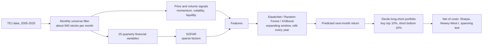

# Taiwan Stock Return Prediction: SOFAR + Machine Learning

Combining sparse factor extraction (SOFAR) with ElasticNet / Random Forest / XGBoost
to predict monthly stock returns in the Taiwan equity market (2005-2025).
Master's thesis research, National Chengchi University (NCCU), Dept. of Economics.

## Key Results

Out-of-sample period: Jan 2016 - Nov 2025 (119 months). All figures are for a
decile long-short portfolio, net of transaction costs (0.6% round trip).

| Metric | Value | What it means |
|---|---|---|
| Sharpe Ratio (XGBoost-Hybrid) | **1.42** | Risk-adjusted return: how much return per unit of risk taken |
| Newey-West t-stat | **5.54** | Statistical significance: is this skill or luck? (>2 is considered significant) |
| Spanning Test alpha | 0.00329 (t = 3.498, p < 1%) | About 0.3% excess return per month that cannot be replicated by the Market-only and SOFAR-only strategies combined |
| Feature importance (Gain) | Market 44.6% / SOFAR 55.4% | Both signal types contribute roughly equally, so SOFAR factors are not decorative |
| Consistency | 9 of 10 years with positive Sharpe | The only negative year is 2025 (tariff shock) |

**Comparison with a passive benchmark** (Yuanta Taiwan Top 50 ETF, ticker 0050, same period):

| | XGBoost-Hybrid (long-short) | 0050 ETF (buy and hold) |
|---|---|---|
| Annualized return | 13.61% | 18.02% |
| Sharpe Ratio | **1.425** | 1.051 |
| Max drawdown | **-8.77%** | -24.29% |

The strategy earns a lower raw return than 0050 but with much better risk-adjusted
performance and far smaller drawdowns. Note that a long-short portfolio and a
long-only ETF are different instruments; 0050 figures are before costs
(negligible for a passive ETF).

See `results/thesis_output/` for full tables and figures.

## The Idea

Taiwan stock returns are noisy, and quarterly financial statements contain many
overlapping numbers (ROA vs. ROE, gross margin vs. operating margin, ...).
Feeding all 25 raw variables into a model is like handing it a messy closet.

**SOFAR (Sparse Orthogonal Factor Regression)** tidies the closet into a few drawers:
each drawer (factor) is built from only a handful of related variables (sparse),
and no two drawers overlap (orthogonal). Compared with PCA, where every drawer
contains a bit of everything, the factors are easier to interpret and less noisy.
(In the thesis, SOFAR versions beat the PCA versions on return, Sharpe and drawdown.)

The research question: **do these cleaned-up fundamental factors carry information
that market signals (momentum, volatility, liquidity) do not?**
To test it, three feature sets are compared across three algorithms (3 x 3 = 9 models),
plus an OLS-3 linear benchmark (size, value, 12-month momentum):

| Feature set | Contents |
|---|---|
| Market-only | Momentum, volatility, liquidity |
| SOFAR-only | Factors extracted from 25 quarterly financial variables |
| Hybrid | Both combined |

## How It Works



Design choices that guard against look-ahead bias and overfitting:

- **Expanding window, annual refit**: each year's model is trained only on data up to the previous December, then predicts the next 12 months.
- **Reporting lag**: quarterly financials are only used after their latest legal disclosure date (e.g. Q1 reports from May), so the model never sees numbers investors did not yet have.
- **Liquidity filter**: each month keeps only stocks above the 30th percentile of both market cap and trading value, at least 30 stocks.
- **Transaction costs**: 0.6% round trip charged on portfolio turnover.
- **Fixed hyperparameters and seed (42)**: set in advance, not tuned on out-of-sample results.

## Repository Contents

| Folder | Content |
|---|---|
| `src/` | R code: full pipeline, thesis tables and figures, comparison with 0050, monthly returns for Appendix D.1 |
| `results/thesis_output/` | Thesis tables (CSV, Tables 4-11, A.1, B.1) and figures (PNG, Figures 1-2) |
| `data/` | Data documentation only (raw TEJ data is licensed and not included) |

Where to look first:

| File | Content |
|---|---|
| `src/pipeline_main.R` | End-to-end pipeline: universe filter, imputation, SOFAR, ML models, portfolios |
| `results/thesis_output/Table7_portfolio_perf.csv` | Portfolio performance of all 10 models |
| `results/thesis_output/Table8_spanning_test.csv` | Spanning test (information complementarity) |
| `results/thesis_output/Figure2_cumret_wealth.png` | Cumulative wealth of the main models |

## How to Run

> The raw data are not included. See [data/README.md](data/README.md)
> for the required input files and their format.

### 1. Install R packages

```r
install.packages(c("data.table", "lubridate", "zoo", "rrpack", "glmnet",
                   "ranger", "xgboost", "sandwich", "lmtest", "ggplot2"))
```

### 2. Prepare the data

Put `monthly_panel_final.csv` and `0050.csv` in the `data/` folder.

### 3. Run the scripts in order

All scripts use relative paths, so run them **from the repository root**
(for example `Rscript src/pipeline_main.R`, or set the RStudio working
directory to the repo root).

| Step | Script | What it does |
|---|---|---|
| 1 | `src/pipeline_main.R` | Universe screening, feature engineering, yearly SOFAR factor extraction, training of all 10 models with an expanding window, and long-short backtest. Results go to `outputs/pipeline_runs/` |
| 2 | `src/output_tables_figures.R` | Builds the thesis tables (Table 4-11, A1, B1) and Figures 1-2 into a `thesis_output/` folder under `outputs/` |
| 3 | `src/backtest_vs_0050.R` | Compares XGBoost-Hybrid with the 0050 ETF over the same out-of-sample period |
| 4 | `src/three_year_annualized_return.R` | Computes rolling 3-year annualized returns, reading the latest run automatically |

### Notes

- The full pipeline takes about **5-6 hours** on a typical laptop.
- Random seeds are fixed (`set.seed(42)`), so results are reproducible.
- `outputs/` is ignored by git. To update the published results, copy the
  files from the generated `thesis_output/` folder into `results/thesis_output/`.
